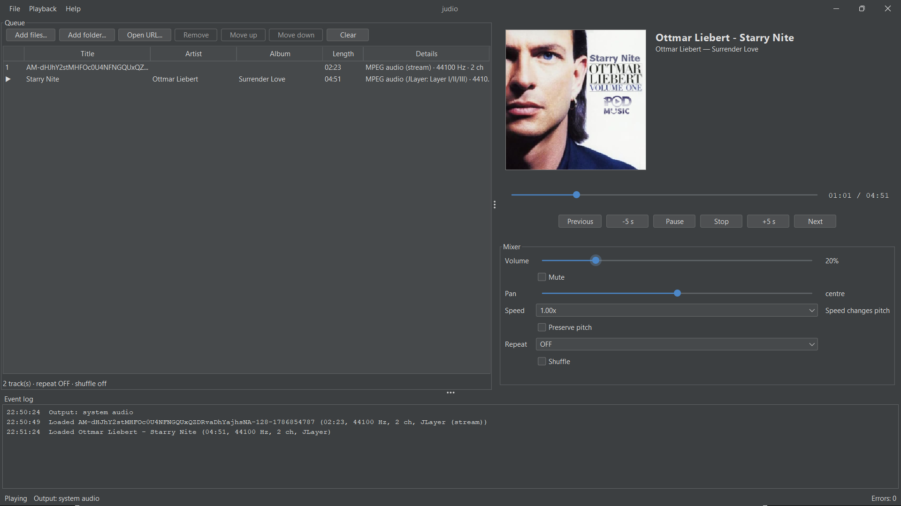

# Judio

**Judio** is an audio playback library for JVM.
It is written in pure Java, so it needs no extra software
installed on your computer.


[](LICENSE-MIT)
[](#requirements)



## Download 
Judio is available on Maven Central


```kotlin
// Gradle (Kotlin DSL)
dependencies {
    implementation("io.github.sina-rz:judio:0.2.1")
}
```

```xml
<!-- Maven -->
<dependency>
  <groupId>io.github.sina-rz</groupId>
  <artifactId>judio</artifactId>
  <version>0.2.1</version>
</dependency>
```

## Try it

You need **JDK 25**. The Gradle wrapper is included, so you do not need to install Gradle.

```bash
./gradlew runGui          # a graphical player
./gradlew run             # a player in the terminal
```

No sound card? Add `--null-audio` to play without sound. The timing is real, but nothing is heard:

```bash
./gradlew run --args="--null-audio song.mp3"
```

## What you can do

- Play MP3, WAV, AIFF, AU, Ogg Vorbis, and Opus files
- Play MP3, WAV, AIFF, AU, Ogg Vorbis, and Opus streams from `http://` or `https://` addresses
- Make a queue, with repeat and shuffle
- Play, pause, resume, stop, seek, skip, and go back
- Set the volume, mute, pan, and speed
- Change the speed without changing the pitch
- Read song titles and artists, and show cover art
- Get events when the song changes, progresses, or fails

## Supported formats

| Format | Status |
|---|---|
| MP3 | Supported (MPEG-1/2/2.5, Layers I, II and III) |
| WAV, AIFF, AU | Supported (PCM and the built-in Java Sound formats) |
| Ogg Vorbis, Opus | Supported in pure Java (mono/stereo) |
| Internet streams (MP3, WAV, AIFF, AU) | Supported. MP3 and WAV can seek if the server supports it |
| HTTP/HTTPS Ogg Vorbis and Opus | Supported incrementally; seeks use HTTP byte ranges and codec preroll when the server advertises range support. Duration is unknown. |
| FLAC and other Ogg codecs | Not supported |


## Build your own player

Start with the **[tutorial](docs/wiki/Tutorial.md)**.
Read the **[core concepts](docs/wiki/Concepts.md)** first if you want to understand how the
pieces fit together.

## For contributors

```bash
./gradlew test            # run the tests
./gradlew benchmark       # measure performance
```

The source code is in `src/main/java/io/github/sinaraz`. The public types are in the top package,
`model`, `error`, and `audio`. Everything in `internal` can change without warning.

## Licence

Judio is released under the MIT License (see [LICENSE-MIT](LICENSE-MIT); the same text ships
inside the jar together with [NOTICE.txt](NOTICE.txt)).